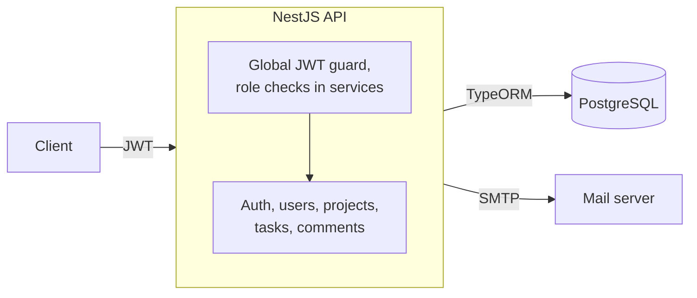

# Project Management System API

A NestJS REST API for team project management: projects, tasks and comments, with Admin, Manager and Developer roles, JWT authentication, email verification codes and password reset by email.

## Overview

An Admin creates user accounts; each new user gets a 6-digit code by email to verify their address. Admins and Managers create projects, add users to them and create, update and delete tasks assigned to users. Everyone signed in can read projects and tasks and comment on tasks.

## Features

- **Accounts:** Admins register users with a role; a 6-digit code (5 minutes) verifies the email; bcrypt-hashed passwords; JWT access tokens.
- **Password reset:** a 15-minute reset link sent by email, usable once.
- **Projects:** create (Admin, Manager), add users, list, read, update and delete (Admin, Manager).
- **Tasks:** created inside a project and assigned to a user; update and delete need an Admin or Manager.
- **Comments:** any signed-in user can comment on a task and read its comments.
- **Protection:** validation that rejects unknown fields, and no passwords, codes or reset tokens in any response.

## Architecture



## Tech stack

NestJS 11, TypeScript, PostgreSQL with TypeORM, Passport JWT, bcrypt, class-validator, Nodemailer through `@nestjs-modules/mailer`, Jest, ESLint and Prettier.

## Getting started

You need Node.js 20 or later (`.nvmrc` pins 22), PostgreSQL and an SMTP account (a Mailtrap sandbox works).

```bash
git clone https://github.com/a-3isa/Project-Management-System
cd Project-Management-System
npm ci
cp .env.example .env                  # then fill in the values
npm run start:dev                     # http://localhost:3000
```

| Variable | Required | Purpose |
|---|---|---|
| `PORT` | no (3000) | HTTP port |
| `DB_HOST`, `DB_PORT`, `DB_USERNAME`, `DB_PASSWORD`, `DB_NAME` | yes | PostgreSQL connection. TypeORM creates and updates the tables on start (`synchronize: true`). |
| `JWT_SECRET` | yes | Signs and verifies tokens; the app will not start without it |
| `JWT_EXPIRES_IN` | yes | Access-token lifetime, e.g. `1d` |
| `MAIL_HOST`, `MAIL_PORT`, `MAIL_USER`, `MAIL_PASS`, `MAIL_FROM` | yes | SMTP server for codes and reset links |

**First admin.** Registering users needs an Admin, so create the first one in the database. Generate a bcrypt hash of the password, then insert it:

```bash
node -e "console.log(require('bcrypt').hashSync(process.argv[1], 10))" 'Your-Passw0rd'
```

```sql
INSERT INTO "user" (email, password, role, "isVerified")
VALUES ('admin@x.io', '<hash from above>', 'Admin', true);
```

For a production build: `npm run build`, then `npm run start:prod`.

## API

All routes need `Authorization: Bearer <token>` except login, forgot-password and reset-password. Log in with `{ email, password, role }`; the email field accepts at most 12 characters.

| Area | Route | Who |
|---|---|---|
| Auth | `POST /auth/login`, `POST /auth/forgot-password` `{ email }`, `POST /auth/reset-password?token=` `{ password }` | Anyone |
| | `POST /auth/register` `{ email, password, role }` | Admin |
| | `POST /auth/verify-otp` `{ email, otp }` | Signed in |
| Users | `GET /users/me`, `GET /users`, `GET /users/:id/tasks` | Signed in |
| | `DELETE /users/:id` | Admin |
| Projects | `GET /projects`, `GET /projects/:id` | Signed in |
| | `POST /projects/create`, `POST /projects/:id/add-user/:userId`, `POST /projects/:projectId/tasks`, `PATCH /projects/:id`, `DELETE /projects/:id` | Admin, Manager |
| Tasks | `GET /tasks/:id`, `POST /tasks/:taskId/comments`, `GET /tasks/:taskId/comments` | Signed in |
| | `PATCH /tasks/:id`, `DELETE /tasks/:id` | Admin, Manager |

## Project structure

```
src/
  auth/      login, registration, email codes, password reset, JWT strategy and guard
  user/      users and roles
  project/   projects and project membership
  task/      tasks and their comments
  comment/   comment entity
```

## Testing and checks

```bash
npm test               # unit tests (Jest)
npm run lint           # ESLint, no fixes applied
npm run format:check   # Prettier
npm run build
```

The unit tests cover token checks, the role checks on projects and users, and that secrets never appear in a serialised user. `test/app.e2e-spec.ts` is still the NestJS starter test, so `npm run test:e2e` does not pass. CI runs lint, format check, build and unit tests on every pull request and on pushes to `main`.

## Security notes

- Tokens are signed and verified with `JWT_SECRET` and carry a type, so a reset token cannot be used to sign in. A token must name an existing user's email.
- Passwords are hashed with bcrypt; passwords, verification codes and reset tokens are never returned or logged.
- Verification codes come from a cryptographic random generator. Reset tokens are stored and accepted only once.
- Role checks protect user creation and deletion, and project and task changes.
- See [SECURITY.md](SECURITY.md) to report a vulnerability.

## Known issues and roadmap

These are bugs in the current code, recorded here rather than hidden:

- Login does not check that the email was verified, and `verify-otp` needs a token, which a new user only gets from the registration response.
- The email field is limited to 12 characters, which rejects most real addresses.
- `forgot-password` reveals whether an email is registered, and there is no rate limit on login or code entry.
- Emails are sent from a fixed demo sender address rather than `MAIL_FROM`.
- Planned: rate limiting, real end-to-end tests, migrations instead of `synchronize`, and upgrades to `@nestjs-modules/mailer` 2 and nodemailer 10.

## License and author

UNLICENSED: the source is public for portfolio review, and no licence is granted to reuse it. Built by Ahmed Ibrahim Hussien ([a-3isa](https://github.com/a-3isa)).
